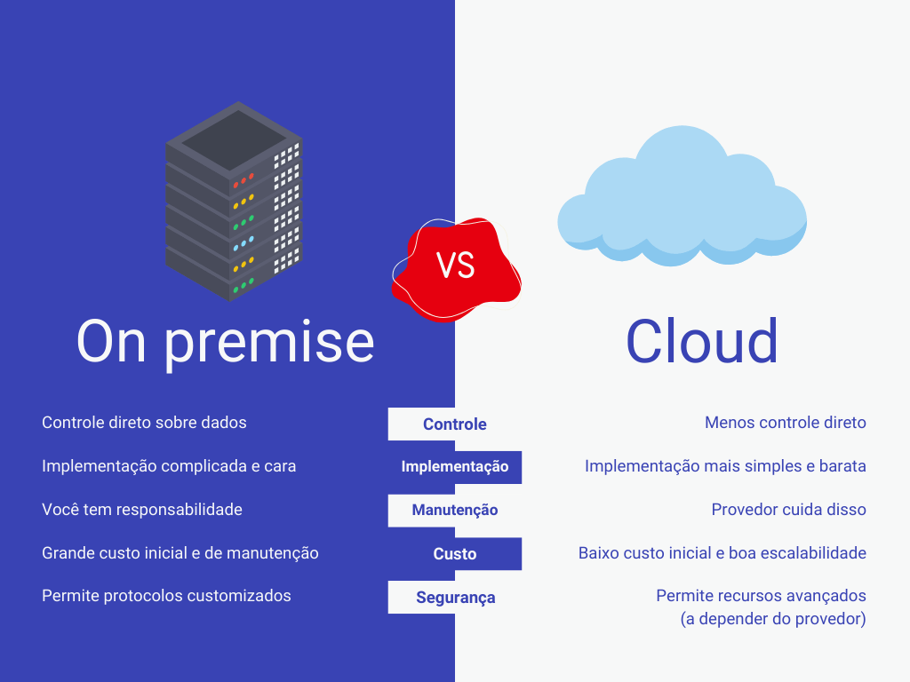

Cloud vs traditional architecture (Arquitetura em Nuvem vs Arquitetura Tradicional)

 a computação em nuvem é muito melhor do que a arquitetura tradicional, pois ela oferece uma variedade de serviços que podem ser utilizados de acordo com a necessidade de cada um, além de oferecer uma melhor escalabilidade, segurança, velocidade, flexibilidade e acessibilidade.

 No lado esquerdo, temos a arquitetura tradicional, onde temos um servidor físico, um banco de dados físico, um armazenamento físico, uma rede física, um software físico, entre outros. Já no lado direito, temos a arquitetura em nuvem, onde temos um servidor virtual, um banco de dados virtual, um armazenamento virtual, uma rede virtual, um software virtual, entre outros.

 

 
1. Controle
As soluções on premise oferecem mais controle sobre os dados e o hardware da sua organização. Afinal, é a sua própria companhia que vai gerir as configurações dos seus servidores e do seu software. Ou seja, ideal para armanezar os dados sensíveis de indústrias altamente reguladas.

Já os sistemas cloud oferecem menos controle direto, mas em troca têm a vantagem de permitir uma ampliação mais fácil do seu espaço de armazenamento. Além disso, você tem um controle mais refinado sobre o valor que será investido no serviço, podendo aumentá-lo aos poucos.

Você ainda tem um controle maior sobre o local de acesso das informações. Isso porque é possível se conectar ao seu servidor de qualquer local que tenha uma conexão à internet, facilitando o trabalho remoto e a colaboração.

2. Implementação
O sistema on premise exige investimentos numa infraestrutura local: seja na forma de espaço para instalação e resfriamento de servidores, seja numa equipe de TI que vá realizar a instalação e manutenção do software escolhido em cada máquina.

Se a sua empresa estiver operando na nuvem, a implementação tende a ser mais simples. A maioria dos provedores de serviços cloud oferece algum tipo de gestão ou auxílio de implementação.

Caso você escolha uma solução do tipo low-code ou no-code, seu serviço estará no ar muito mais rápido se comparado a qualquer outra opção. Isso também vale para a adoção de novos recursos, que acontece com maior agilidade num ambiente de nuvem.

3. Manutenção
Se você adotar o modelo on premise, a sua organização vai precisar lidar internamente com a manutenção do hardware, a atualização dos softwares e a instalação de patches de segurança. Será necessário equilibrar bem o tempo dos membros da sua equipe de TI e o investimento em serviços terceirizados de suporte.

Os provedores de cloud computing são responsáveis pela manutenção, atualizações e upgrades do software contratado ou do sistema operacional do servidor. Isso garante que os sistemas estarão sempre atualizados com os últimos recursos e melhorias de segurança.

4. Custo
O grande ponto de contenção para os servidores on premise é o alto investimento inicial exigido. Sua empresa precisará adquirir o hardware e desenvolver a infraestrutura necessária para rodar o software ou os servidores escolhidos. Você ainda deverá arcar com os custos de manutenção contínua, energia consumida e colaboradores para gerenciá-los.

Enquanto isso, o modelo de cloud costuma operar com assinaturas mensais, anuais ou em períodos customizáveis. Portanto, o custo inicial é muito mais baixo: sua empresa pode começar com a assinatura mais barata e ir ampliando seu plano conforme vai crescendo.

Você precisará investir menos recursos humanos e financeiros na manutenção, pois o provedor também lida com a manutenção de hardware e software. O único porém da computação em nuvem é que você pode acabar gastando mais do que no modelo on premise se a sua empresa ficar grande demais, com um uso intensivo de recursos.

5. Segurança
Organizações que lidam com informações altamente sensíveis, como bancos e agências governamentais, devem pelo menos manter determinados dados armazenados em servidores locais de sua propriedade. Muitas vezes isso é até uma questão de conformidade, pois é uma exigência das legislações de diversos países.

Outra vantagem da solução on premise nesse caso é a possibilidade de customização, com a abertura para implementar protocolos de segurança customizados para as necessidades da sua empresa.

Servidores cloud são uma faca de dois gumes. Você até tem acesso a recursos avançados de segurança e determinadas certificações de compliance. Mas os seus dados e as informações de clientes serão armazenados num servidor terceirizado, o que aumenta os riscos de vulnerabilidades.

É importante verificar se a legislação da sua indústria em particular permite o armazenamento de determinados dados em servidores cloud. Também é preciso usar o bom senso para escolher quais informações devem ser armazenadas de modo local e quais devem ficar na nuvem. Assim, você evita a possibilidade de um vazamento de dados.

 Nos tempos atuais, a maioria das empresas opta por soluções em nuvem, pois ela oferece uma variedade de serviços que podem ser utilizados de acordo com a necessidade de cada um, além de oferecer uma melhor escalabilidade, segurança, velocidade, flexibilidade e acessibilidade. A google por exemplo tem mais de 300 serviços disponíveis em sua plataforma, o que permite que as empresas escolham os serviços que melhor atendem às suas necessidades.