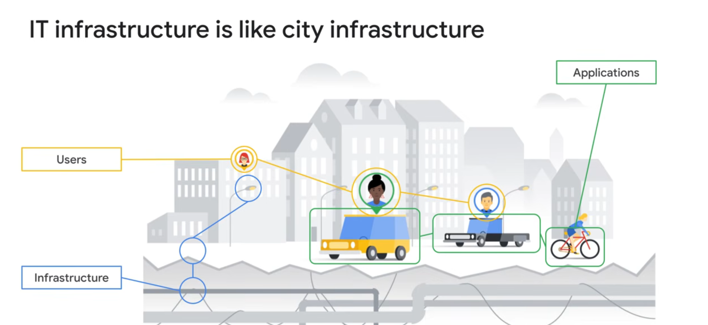

o que é computação em nuvem?

Computação nuvem é a entrega de varios serviços em um ambiente só, como por exemplo : servidores, banco de dados armazenamento, inteligencia artificial, redes, software, entre outros. Diferente do tradicional computação em nuvem oferece uma melhor escalabilidade, segurança, velocidade, flexibilidade e acessibilidade. 

Nessa imagem podemos observar que foi utilizado uma analogia de toda estrutura que uma cidade deve ter para que ela funcione,como: energia, água, transporte, segurança entre outros, para ter uma comparação com a computação em nuvem.

